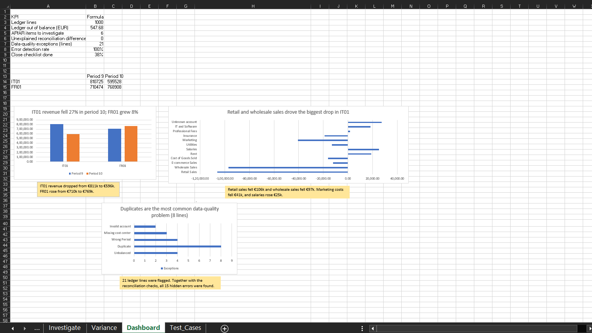
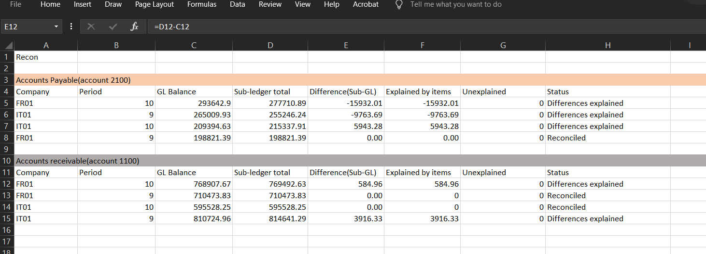
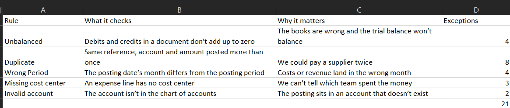
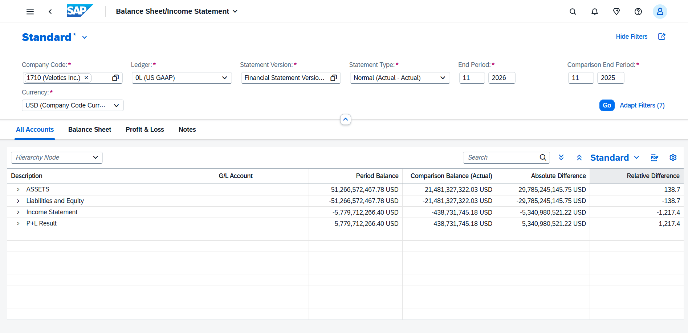
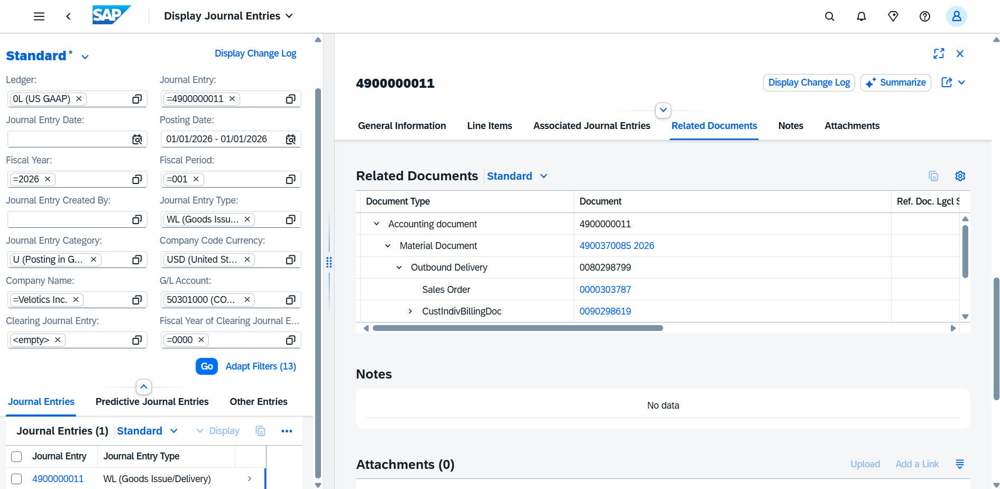
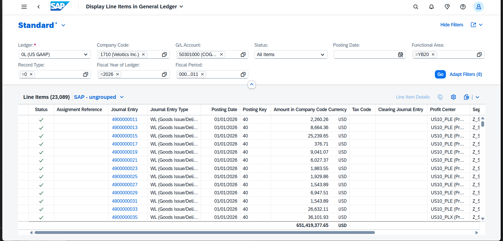

# Month-End Close & Reconciliation Toolkit

*A project I built to learn how finance teams close the books, and how the checks behind that process work.*

**At a glance:** 2 fictional companies · about 1,000 ledger lines · 15 hidden errors · 15 found · 14 test cases · 1 SOP. All ledger data is synthetic.

## Why I built this
I'm new to finance. When I read about what an IT finance team does (month-end close, reconciliations, testing, documentation), I realised I didn't understand how any of it actually worked. So I decided to build a small version myself and learn by doing.

## What I built
- A Python script (pandas) that generates SAP-style ledger data: about 1,000 lines, supplier and customer lists, and a chart of accounts. It also hides 15 known mistakes and keeps an answer key.
- A second Python script (src/reconcile_check.py) that recomputes the trial balance, reconciliation and data-quality flags independently and checks that they agree with my workbook.”
- An Excel workbook with live formulas that:
  - builds a trial balance by company and period,
  - reconciles the supplier and customer lists to the ledger,
  - flags suspicious postings with five data-quality rules,
  - scores those rules against the answer key,
  - tracks the close with a checklist, accruals and reversals,
  - compares two periods and explains the big changes,
  - summarises everything in a dashboard.
- 14 test cases, a log of simulated defects, and a one-page SOP.

## What I found
- The trial balance is out of balance for IT01 in period 10 (by 465.50) and FR01 in period 9 (by 82.18). Both come from unbalanced journal entries.
- The reconciliation found 6 invoices that disagree between the lists and the ledger (4 supplier, 2 customer): missing, duplicated or with a different amount. I explained every difference.
- The data-quality rules flagged 21 ledger lines in 13 documents. Together with the reconciliation, they caught all 15 hidden errors. I wrote the rules for the known error types, so this doesn't prove they would catch errors I didn't expect.
- The variance review flagged 5 lines above EUR 20,000 and 20%. For each one I checked the number of lines and the average size before writing a comment.
- One of my own mistakes: my first trial balance said "Balanced" while it was actually empty, because I had typed a wrong period. I added a check that confirms data was found.

## How I tested it
- 14 test cases across record-to-report, procure-to-pay and order-to-cash.
- I ran 10: 8 passed and 2 failed because they found real data problems. 4 were not run because they need posting in an SAP system.
- 7 tests ran in my workbook. 3 were display-only tests in the SAP S/4HANA Cloud trial, where I followed guided tours (financial statement, journal entry with related documents, general ledger line items). I did not post or configure anything in SAP.
- I logged 6 simulated defects with severity, owner and next step.

## Screenshots

## Run it yourself
1. `pip install pandas numpy xlsxwriter openpyxl`
2. `python src/generate_data.py`
3. Open `workbook/month_end_close_toolkit.xlsx`. It already contains the data, so don't use Refresh All (its data connections point to files on my computer).

## Folder guide
`src/` Python data generator · `data/` generated files and the answer key · `workbook/` Excel workbook · `docs/` SOP, test cases and learning log · `screenshots/`

## Limits
- The ledger data and companies are fictional. The SAP screenshots show SAP's own sample data.
- It was built in a few days while learning the basics of finance, by one person.
- 4 test cases (posting and closed-period tests) were not run.

## What I would do next
- Add foreign currencies and VAT.
- Extend the Python check into a fully automated close process.
- Run the posting test cases in a real SAP S/4HANA system.

## What I learned
- A reconciliation isn't done until every difference is explained.
- "Balanced" means nothing unless the sheet actually found data.
- A test that fails can mean the data is wrong, and a test that passes can mean my check caught the error.
- Writing down what I did **not** test is as important as writing down what I did.

My day-by-day notes are in [docs/learning_log.md](docs/learning_log.md).

## How I worked
I used an AI assistant as a tutor while building this. It guided me step by step when I needed help, and I checked every result myself.